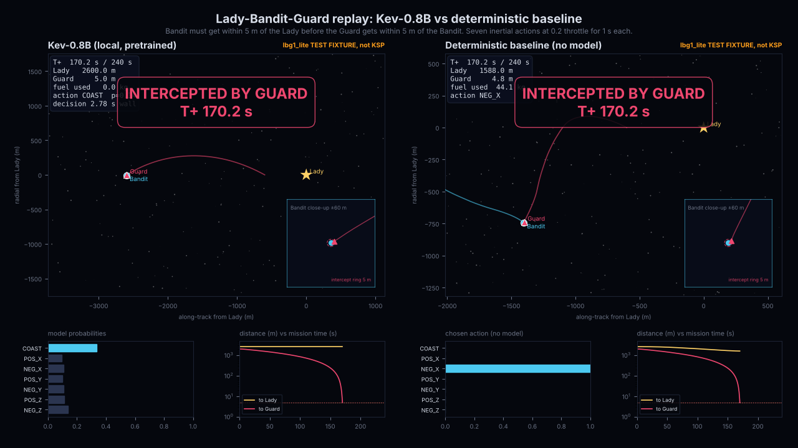
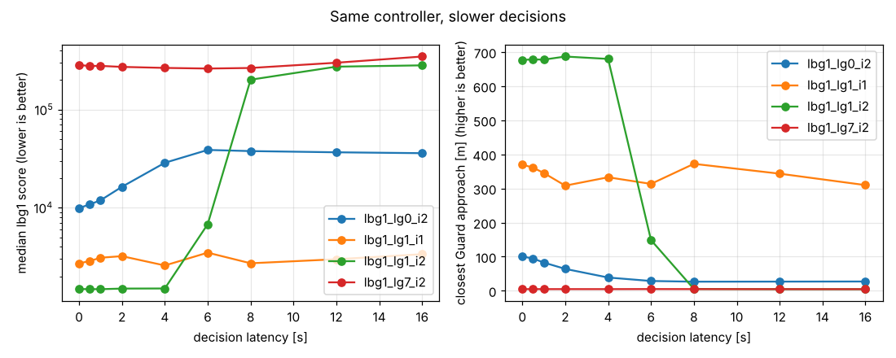

# Hierarchical AI for Autonomous Spacecraft

**Sundai Hack 144 · Hack144: Autonomous Spacecraft**

Can a slow, capable planner and a fast, small decision model fly a spacecraft together? This project
tests a three-layer controller on Lady-Bandit-Guard, a scenario from KSPDG (the Kerbal Space Program
Differential Games suite). We fly the Bandit. The goal is to reach the Lady without being
intercepted by the Guard.

- **Play the game:** <https://zihuahe.github.io/hierarchical-spacecraft-control/>. You fly the Bandit
  yourself in a browser, on a computer or a phone.
- **Project page:** [Sundai Club project](https://www.sundai.club/projects/2f46263e-d3db-45c1-8091-df5b2683bf22)
- **Code:** this branch, `claude/project-thread-w6vikd`. The [layout](#layout) lists what is where.
- **Replay video:** [Kev-0.8B vs a deterministic baseline](results/replay/kev_vs_rule_fixture.mp4)
  (on the stand-in simulator)

## Where it stands (2026-10-12)

The real-game control loop is written and tested, and the local Kev-0.8B model answers its requests
correctly. The loop has not yet run against Kerbal Space Program itself, because the cloud machine we
built on has no KSP install with kRPC. Every result marked **fixture** ran on `lbg1_lite`, a
pure-Python stand-in for the game, not on KSP.

| Stage | Done when | Status |
|---|---|---|
| A. Environment | One real observation and the effective scenario settings are recorded. | **Blocked.** Needs a host running KSP with kRPC. KSPDG 0.15.0 installs, the scenario builds, and its effective rules were read from the environment: 240 s timeout, 5 m capture, 10 m interception. |
| B. Local model | A valid structured response returns from the local Kev server. | **Done.** A real Kev-0.8B server on CPU answered 22 of 22 Choice requests with valid action IDs. Median latency was 1.97 s, p95 2.30 s. |
| C. First control loop | One validated action executes and the next observation is recorded. | **Fixture only.** It works end to end on `lbg1_lite` with real Kev, but has not run in KSP. |
| D. Episode | An actual episode has a local trace and a reported outcome. | **Fixture only.** Kev coasted all 171 steps and the proxy Guard intercepted the Bandit at 170.2 s. |
| E. Hierarchy experiment | Comparable trials with latency and outcome measurements are available. | **Not started** on the real loop. No-model latency experiments ran on the fixture. |

Also built: a deterministic baseline over the same seven actions (`--decider rule`), a replay renderer
for loop traces, and the browser game. The game's physics is checked against the Python simulator by
the test suite.

**What we learned so far.** Pretrained Kev-0.8B is wired up correctly but shows no sign of steering:
every answer was `COAST`, at about 0.27 probability against 0.14 for a uniform guess. The
deterministic baseline closed to 1,588 m of the Lady, but at 0.2 throttle it can't outrun the proxy
Guard either. Neither run tests the hierarchy hypothesis yet.

## 1. Goal and original pitch

- **Mission:** control the Bandit to reach the Lady while avoiding interception by the Guard.
- **Scenario:** `LBG1_LG7_I2_V1`, with a 240-second mission.
- **Immediate model:** local Kev-0.8B, pretrained, with no fine-tuning.
- **First milestone:** real observation → Kev decision → validated thrust command → next observation.
- **Presentation goal:** show a working controller and, if integration permitted, compare it with
  hierarchical guidance at the 20:00 final presentations.

### Heiko's original pitch: hierarchical spacecraft control

> For the presented space control game, use a hierarchical controller: a global policy (e.g., Opus)
> encodes a context (mission objectives etc.), a mid-level controller (e.g., Haiku) takes several
> images and creates a short-term set of objectives on a rolling basis, and a low-level controller
> (e.g., JEV) selects actions based on the higher-level contexts quickly.

### Current adaptation

We keep the three-layer idea, but start with numerical spacecraft observations and Kev-0.8B as the
open-source immediate decision model. Screenshots and the higher-level planners come after the basic
connection works. The original pitch remains the project direction; the first deliverable is
deliberately smaller.

### Hypothesis

Slower planners can set strategy and update short-term objectives while a fast decision model handles
immediate actions. We need to measure whether this separation improves control while keeping decision
latency manageable. A Kev-only run proves integration, not the hierarchy hypothesis.

## 2. Spacecraft task

Lady-Bandit-Guard is a KSPDG scenario that runs inside Kerbal Space Program. We control the Bandit.
The Lady is the target and the Guard is the opponent. Capture means crossing a distance threshold,
not docking or colliding.

| Outcome | Rule | Value in `LBG1_LG7_I2_V1` (read from KSPDG 0.15.0) |
|---|---|---|
| Capture | The Bandit gets within `lady_capture_dist` of the Lady. | 5 m |
| Interception | The Guard gets within `bandit_capture_dist` of the Bandit. | **10 m.** The base default is 5 m, but LG7 overrides it. |
| Timeout | Mission time reaches `episode_timeout`. | 240 s |

Use the environment's own termination result and metrics. Don't infer success from a screenshot, and
don't substitute a different scenario without saying so.

## 3. Controller inputs and outputs

### Inputs

Each observation has nine input groups with 21 numbers in total. Positions are in meters and
velocities in meters per second, all in the same right-handed celestial-body-centered inertial frame
(CBCI).

| Index | Input | Shape and units | Meaning |
|---|---|---|---|
| 0 | Mission time | 1 number; s | Elapsed mission time. |
| 1 | Bandit mass | 1 number; kg | Current spacecraft mass. |
| 2 | Bandit fuel | 1 number; KSP resource units | Remaining MonoPropellant. The upstream docstring says kg, but the value is in KSP resource units. |
| 3:6 | Bandit position | 3 numbers; m | Our position: x, y, z. |
| 6:9 | Bandit velocity | 3 numbers; m/s | Our velocity: vx, vy, vz. |
| 9:12 | Lady position | 3 numbers; m | Target position. |
| 12:15 | Lady velocity | 3 numbers; m/s | Target velocity. |
| 15:18 | Guard position | 3 numbers; m | Opponent position. |
| 18:21 | Guard velocity | 3 numbers; m/s | Opponent velocity. |

**Features computed in code,** for both the Lady and the Guard:

- Time remaining: `max(0, episode_timeout − mission time)`.
- Relative position: target position − Bandit position.
- Relative velocity: target velocity − Bandit velocity.
- Distance: the length of the relative position.
- Closing speed: `−dot(relative position, relative velocity) / distance`. Positive means approaching.
  The zero-distance case is handled.
- Recent state and action history, and fuel used, from locally stored previous readings.

The state sent to Kev stays compact and includes units. Kev is never asked to do the vector maths.
The 21-number observation has no attitude and no screenshots.

### Outputs

A simulator command holds a three-axis burn vector with a duration, a reference frame and a vector
type:

```json
{"burn_vec": [x, y, z, duration], "ref_frame": 1, "vec_type": 0}
```

Throttle runs from −1 to +1 on each axis, and duration from 0 to 10 s. `ref_frame = 1` is right-handed
CBCI, the same axes as the observation. `vec_type = 0` means throttle. The environment rotates the
vector into spacecraft controls.

`ref_frame = 0` is the spacecraft's body frame, which the first action catalog doesn't use. Its axes
are not interchangeable with inertial x, y and z:

| Body axis | Range | Sign |
|---|---|---|
| Forward / backward | −1 to +1 | Positive is forward. |
| Right / left | −1 to +1 | Positive is right. |
| Down / up | −1 to +1 | Positive is down. |
| Duration | 0 to 10 s | |

Things to keep in mind:

- Zero thrust doesn't stop the spacecraft. It coasts.
- The forward and backward axes have 8 thrusters and the others have 4. The same inertial throttle can
  therefore give a different acceleration depending on attitude.
- Mission time and wall time are different clocks, and the burn runs for `duration` seconds of
  **wall-clock** time. The loop logs both clocks.

### Action catalog

Seven inertial-axis actions, so no attitude calculation is needed. The magnitude (0.2) and duration
(1.0 s) are configurable connection-test settings, not a demonstrated flight policy.

| Action ID | Burn vector: x, y, z, duration |
|---|---|
| `COAST` | `[0, 0, 0, 1.0]` |
| `POS_X` | `[0.2, 0, 0, 1.0]` |
| `NEG_X` | `[−0.2, 0, 0, 1.0]` |
| `POS_Y` | `[0, 0.2, 0, 1.0]` |
| `NEG_Y` | `[0, −0.2, 0, 1.0]` |
| `POS_Z` | `[0, 0, 0.2, 1.0]` |
| `NEG_Z` | `[0, 0, −0.2, 1.0]` |

Kev picks only an action ID. The adapter looks up the vector, adds `ref_frame = 1` and `vec_type = 0`,
and checks the ID, finite values, limits and duration before anything executes.

## 4. Controller architecture

| Layer | Responsibility | Proposed model | As built |
|---|---|---|---|
| Mission strategy | Set the mission, priorities and constraints. | Claude Opus | The real loop uses fixed mission text built from the scenario's effective rules. An Opus strategist is implemented for the fixture experiments. |
| Tactical planning | Review recent states and update a short-term objective. | Claude Haiku | Implemented for the fixture experiments, but not yet on the real loop. |
| Immediate decisions | Pick one option from the fixed action catalog. | Kev-0.8B | **Done.** A local server answers one Choice question per observation. |
| Decision engine / adapter | Prepare features, validate the choice, map it to a command and log it. | None, plain Python | [`hsc/kspdg_loop.py`](hsc/kspdg_loop.py) |

Jev is TypeSafe's original typed-decision model. Kev is an independent open-source alternative that
serves the same API. A compatible interface doesn't mean the same accuracy, confidence or performance.

### Adding the hierarchy after the first loop

The comparison keeps the same observation adapter and action catalog, so it isolates the value of
guidance. Using local Kev for immediate decisions doesn't make hosted Opus or Haiku inference offline.

| Layer | Proposed output | Update policy |
|---|---|---|
| Mission strategy | Mission objective, priorities and constraints, plus a strategy version. | Once per episode at first. |
| Tactical guidance | Short-term objective, preferred and avoided actions, context version and expiry. | Rolling updates from recent numerical history, on an interval chosen after measuring latency. |
| Immediate selection | One action ID from the fixed catalog. | One validated decision per control step. |

These schemas and schedules are proposed interfaces. Slow planners run separately from the immediate
loop. The loop keeps the latest valid context, discards expired or stale results, and logs the context
age and version with every action. Screenshots remain optional later work.

## 5. Build plan

**Priorities.** P0: a real one-action trace, then a reproducible episode. P1: a deterministic and
Kev-only comparison, then the hierarchy if P0 works. P2: screenshots and a frontend. There is no
fine-tuning in this hack.

### Handoff checklist

| Item | Status |
|---|---|
| Environment host, launch command and connection verified | **Blocked.** No KSP with kRPC on the build machine. |
| Selected scenario and effective rules recorded | **Done** from the KSPDG environment object (240 s, 5 m, 10 m), not yet from a live game. |
| Local Kev Choice request verified | **Done.** [`results/kev-local/kev_check.json`](results/kev-local/kev_check.json) |
| Real one-action control loop and trace captured | **Fixture only.** [`results/kev-fixture-check/`](results/kev-fixture-check/) |
| Episode run and metrics captured | **Fixture only.** Kev and baseline traces, plus the replay video. |
| Hierarchy comparison completed | **Not started** on the real loop. |

### Environment facts

| Fact | Recorded |
|---|---|
| Simulator host OS, architecture and where the game runs | Not yet. It needs a host with KSP. |
| Repository and extracted KSP paths on that host | Not yet. |
| Launch command, Python version and KSPDG revision | Python 3.12; `kspdg` 0.15.0 (`mit-ll/spacegym-kspdg` at `6251ca3`); `python -m hsc.kspdg_loop --env kspdg --steps 0` |
| kRPC address and ports | KSPDG connects with kRPC's defaults, `127.0.0.1:50000` (RPC) and `50001` (stream). Container networking is not set up yet. |
| Loaded scenario, effective timeout and capture distances | `LBG1_LG7_I2_V1`, 240 s, 5 m capture, 10 m interception. These were read from the environment object, not yet from a live game. |

### Setup

Heiko's original setup approach was to clone both speaker repositories, unzip the supplied KSP game
next to them, and install Python, Docker and uv. Neighboring folders alone don't configure mounts or
networking, so follow the checked-out runtime guide. The verified commands for KSPDG and the loop are
in [Exact commands](#exact-commands).

**Kev, local.** The selected checkpoint is `jaredpalmer/kev-0.8b@v1.0`. It has downloadable weights
and Apache-2.0 licensing, and returns typed decisions with probabilities instead of generated prose.
Its general benchmarks say nothing about spacecraft competence, so we measure this task directly. Use
Python 3.12 or 3.13 and [uv](https://docs.astral.sh/uv/). Don't use `pip install kev`, which is an
unrelated package.

```bash
git clone https://github.com/jaredpalmer/kev.git && cd kev
uv sync --extra serve
HF_HUB_DISABLE_TELEMETRY=1 DO_NOT_TRACK=1 uv run --extra serve python -m kev.serve \
    --run jaredpalmer/kev-0.8b@v1.0 --host 127.0.0.1 --port 8009
curl --fail http://127.0.0.1:8009/v1/models   # metadata means the server is up
```

A metadata response confirms the server is reachable, and a real Choice request confirms inference.
If the controller runs inside Docker, its `localhost` is the container, so point `--kev-base-url` at
the host.

<details>
<summary>Choice request and response</summary>

`POST /v1/systemone` with compact numerical features in `state` and one `action` Choice question:

```json
{
  "model": "kev-latest",
  "state": "Mission objective and numerical spacecraft features go here.",
  "questions": {
    "action": {
      "type": "choice",
      "instructions": "Choose the next short burn to approach Lady while avoiding Guard. Use the stated inertial coordinate frame.",
      "criteria": {
        "COAST": "No thrust for this interval.",
        "POS_X": "Positive inertial X throttle.",
        "NEG_X": "Negative inertial X throttle.",
        "POS_Y": "Positive inertial Y throttle.",
        "NEG_Y": "Negative inertial Y throttle.",
        "POS_Z": "Positive inertial Z throttle.",
        "NEG_Z": "Negative inertial Z throttle."
      }
    }
  }
}
```

Read `answers.action.choice`. The loop logs the returned confidence and probabilities, but they are
not a calibrated chance of mission success, and the answer is not itself a simulator command.

</details>

### One sequential control loop

1. Read and validate a fresh observation.
2. Calculate features and prepare a compact model state.
3. Request one action from Kev, with a finite timeout.
4. Check the response, the action ID and the observation's age.
5. Map the ID to a validated simulator command and execute it.
6. Record the next observation and episode metrics, and repeat only while the simulator is active.

Burns never overlap. On an invalid input, a timeout, a stale decision or a lost connection, the loop
stops with a clear reason and cleans up the environment. It never executes a guessed fallback, because
coasting isn't always safe.

### Configuration and trace

The scenario, episode timeout, thrust magnitude and duration, model endpoint, request timeout, maximum
observation age and history length are all flags. Timing thresholds should be set from measurements on
the host, not treated as verified defaults. Each run writes a local JSONL trace with a run header
(configuration, effective rules, dependency and model revisions) and one record per decision: step,
both clocks, raw observation, features, context version and age, choice and confidence, burn command,
next observation, latency, and the terminal or error reason. Details are in the
[technical reference](#action-catalog-and-request).

<details>
<summary>Coding-agent handoff (from the build brief)</summary>

Implement the smallest real KSPDG + local Kev-0.8B control loop in the existing team repository.

- Inspect the repository instructions and existing code first. Use sections 2–5 as the interface
  specification, and check the installed upstream version before assuming signatures or settings.
- Keep the real KSPDG scenario as the execution target. Don't replace it with a generated simulator, a
  fake model response or an unannounced alternate scenario.
- Reuse the working environment setup. Discover host paths, launch commands and connection details
  where possible, and ask only for runtime facts that can't be discovered.
- First prove local Kev inference on its own. Implement feature preparation, one Choice request, a
  fixed action mapping, validation and local JSONL logging.
- Expose a one-action connection test and an episode mode. Use the environment's actual
  reset/step/termination API rather than assuming the standard Gym return format.
- Handle finite request timeouts, invalid observations or responses, stale results and connection
  errors explicitly. Keep inference and logging local, and turn off cloud experiment logging.
- Write focused checks for observation parsing, action mapping and invalid-response handling, and label
  fixtures and mocks clearly.
- Record the exact working startup and run commands, dependency revisions and model revision in the
  README.
- Produce a trace showing a real observation, a real Kev selection, the executed command and the next
  observation. Then run and report an episode if the simulator is available.
- If the simulator is blocked, finish the model and adapter checks, report the exact blocker, and keep
  the real-run task open.

Acceptance: a real observation → local Kev decision → valid command → next observation, with a
reproducible command and trace. Integration success doesn't yet mean successful navigation or a
measured hierarchy benefit.

</details>

## 6. Demo and evaluation

| Comparison | Status |
|---|---|
| A simple deterministic controller using the same seven actions | Built (`--decider rule`). On the fixture it closed to 1,588 m of the Lady and was intercepted at 170.2 s. |
| Kev with the fixed mission objective | On the fixture, Kev coasted every step and was intercepted at 170.2 s. |
| Kev with mission strategy and rolling tactical guidance | Not run on the real loop yet. |

Comparisons keep the scenario, initial conditions, opponent, action catalog and command limits the
same, and repeat trials where feasible. A coast-only run checks wiring but is a weak performance
baseline, and a single lucky run is not proof of the hypothesis.

**What to record:** capture, interception or timeout, with the simulator's terminal metrics; closest
distances to the Lady and the Guard; fuel used; median and p95 end-to-end decision latency, measured
after warm-up on changing observations; invalid selections, timeouts, stale results and failed runs;
and model calls with planner and context versions. Simulation time stays separate from wall time.

**Presentation:** explain the Lady, Bandit and Guard and the chosen task; show the control loop and
which parts are Kev and which are ordinary code; play a replay or show a trajectory plot; present
measured outcomes and latency, then explain what remains unfinished. The replay video and the browser
game were built for this.

## 7. Materials

**Speaker materials**

- KSPDG Lady-Bandit-Guard scenario, in [mit-ll/spacegym-kspdg](https://github.com/mit-ll/spacegym-kspdg):
  the scenario description and the observation and action implementation.
- ARCLab KSPDG Docker setup, in [ARCLab-MIT/kspdg](https://github.com/ARCLab-MIT/kspdg): the setup entry
  point for the supplied Linux game environment. Some instructions may need adjusting.
- The supplied `KSP_linux.zip` archive with the Linux game files. A downloaded archive alone doesn't
  prove the scenario runs.
- A `docs/docker_execution.md` guide was suggested during setup. It isn't in `mit-ll/spacegym-kspdg`
  v0.15.0 or in `ARCLab-MIT/kspdg` main, so it presumably came with the speaker materials.

**Implementation references**

- KSPDG observation source, and action and frame-conversion source, in `mit-ll/spacegym-kspdg`.
- Kev: [source and setup](https://github.com/jaredpalmer/kev) and the
  [Kev-0.8B model card](https://huggingface.co/jaredpalmer/kev-0.8b) with its limitations.
- TypeSafe Jev, the original System One concept.

**Event.** Sundai Hack 144. The morning covered AI news, autonomous-spacecraft research, project
pitches and team formation, with a 14:00 lunch check-in, an optional 16:00 run or bike ride, and final
presentations at 20:00.

## Team and credits

- Built at Sundai Hack 144, hosted by [Sundai Club](https://www.sundai.club/). The team is listed on the
  [project page](https://www.sundai.club/projects/2f46263e-d3db-45c1-8091-df5b2683bf22).
- Original pitch by Heiko.
- Much of the code, the replay renderer and the browser game were written with
  [Claude Code](https://claude.com/claude-code).

---

## Technical reference

The engineering notes behind the status above: what the installed KSPDG actually does, the exact
commands, the measured results, the replay video, the browser game, the stand-in simulator and the
fixture experiments.

### Layers in the fixture experiments

In the fixture experiments on `lbg1_lite`, a slow model sets strategy, a mid-speed model updates
short-term goals, and a fast layer picks actions.

| Layer | Default model | Runs | Output |
|---|---|---|---|
| Mission strategy | Claude Opus (`claude-opus-5-5`) | once before the episode | mission brief: objective, approach, keep-out radius, speed limits, fuel reserve, re-plan period |
| Tactical planning | Claude Haiku (`claude-haiku-5-5`) | asynchronously, every `tactical_period_s` | short-term goal: waypoint (Lady-relative), limits, mode hint |
| Immediate control | Kev-0.8B (open weights, local server); hosted Jev also supported | every 0.25 s whenever free | one raw action (coast/forward/backward/left/right/up/down) or one of six guided maneuvers |
| Executor | code, no model | every 0.25 s | lbg1 thrust command |

Kev is an open-source, Jev-compatible classifier ([jaredpalmer/kev](https://github.com/jaredpalmer/kev),
weights on Hugging Face). It runs locally and serves TypeSafe's System One API, so the same client
talks to Kev or to hosted Jev. It answers a `choice` question over a fixed option list and doesn't
write text. Two modes are wired up:

- **Raw actions (`lbg1_lite` experiments):** Kev returns one action ID: coast, forward, backward, left,
  right, up or down. An adapter maps it to a fixed-strength throttle command. `up` and `down` execute
  as a coast, because the controller API has no up/down axis.
- **Guided maneuvers:** the immediate-control layer is split in two. Jev picks a maneuver primitive (`APPROACH_LADY`,
`GO_TO_WAYPOINT`, `BRAKE`, `EVADE_GUARD`, `HOLD_STANDOFF`, `COAST`). A deterministic executor then
turns that primitive into thrust, using Clohessy-Wiltshire relative-motion guidance in the Lady's
LVLH frame. Guided configurations share the same executor, so they differ only in *who decides* and *how
long deciding takes*.

### Real loop: KSPDG observation, Kev choice, burn, next observation

`hsc/kspdg_loop.py` is the execution path for the real game. Its target is the KSPDG scenario
`LBG1_LG7_I2_V1`. Each step reads one observation, asks the local Kev server for one action ID,
validates the burn, sends it, and reads the next observation. Burns never overlap: the next request
is only sent after `env.step()` returns.

#### What the installed KSPDG actually does

Checked against `kspdg` 0.15.0 (`mit-ll/spacegym-kspdg` at `6251ca3`, whose code matches tag `v0.15.0`, installed with
`[adv_bots,viz_tools]` on Python 3.12 and Linux x86_64):

- **LG7 rules differ from the base defaults.** `LBG1_LG7_I2_V1` resolves to the obfuscated
  `LBG1_LG7_I2_Env` (parent `LBG1_LG6_ParentEnv`). An instance reports `episode_timeout=240.0`,
  `lady_capture_dist=5.0` and **`bandit_capture_dist=10.0`**, so the Guard intercepts at 10 m, not
  5 m. `loadfile` is `lbg1_i2_init`. The loop reads these values from the env, records them in the
  run header as `scenario_settings`, and builds Kev's mission text from them.
- **Constructor:** `__init__(self, **kwargs)`. The loop always passes `episode_timeout`, then checks
  the value the env reports.
- **Without `juliacall`**, `kspdg.LBG1_LG7_I2_V1` is a placeholder that returns an error *string*.
  The loop reports this as `env_unavailable`. LG7's Guard runs Julia (`iLQGames`, `FromFile`):
  install Julia and run `kspdg-install-julia-deps`. `lbg1_base.py` imports `dearpygui`, so the
  `viz_tools` extra is needed too. Obfuscated environments ship for Python 3.9, 3.10, 3.12 and 3.13,
  not 3.11.
- **API:** `reset()` returns `(obs, info)` and connects through `krpc.connect(name='kspdg_env')`, which
  uses kRPC's defaults of `127.0.0.1:50000` (RPC) and `50001` (stream). `step(action)` returns
  `(obs, reward, done, info)`. The burn runs as a **wall-clock** busy-wait of `burn_vec[3]` seconds and
  stops early when the episode ends.
- **Termination:** a background thread sets `env.is_lady_captured` and `env.is_bandit_captured`, or
  times out when the Bandit's MET passes `episode_timeout`. These flags live on the env object, not in
  `info`. The loop reads them and reports `capture`, `interception`, `capture_and_interception`,
  `timeout` or `simulator_done`.
- **Fuel:** `obs[2]` is `resources.amount('MonoPropellant')`, which is in KSP resource units even though
  the docstring says kg. The loop keeps it as `bandit_fuel_raw` and `fuel_used_raw`, and also logs
  `mass_used_kg` from `obs[1]`. KSPDG's `info["bandit_fuel_usage"]` is a mass difference in kg.
- **Action:** a `Dict` of `burn_vec` (Box, −1..1 ×3 and 0..10 s), `ref_frame` (Discrete(3); 1 = right-handed
  CBCI) and `vec_type` (Discrete(3); 0 = throttle). With `ref_frame=1` the env rotates the vector into the
  body frame. The forward/reverse axes have 8 thrusters and the others 4, so the same inertial throttle
  can give different accelerations depending on attitude.

#### Action catalog and request

Inertial axes (right-handed CBCI), `ref_frame=1`, `vec_type=0` throttle, 1.0 s:

| ID | burn_vec |
|---|---|
| `COAST` | `[0, 0, 0, 1.0]` |
| `POS_X` / `NEG_X` | `[±0.2, 0, 0, 1.0]` |
| `POS_Y` / `NEG_Y` | `[0, ±0.2, 0, 1.0]` |
| `POS_Z` / `NEG_Z` | `[0, 0, ±0.2, 1.0]` |

Kev gets `POST /v1/systemone` with `model: "kev-latest"`, a JSON `state`, and one `choice` question
named `action` over the seven IDs. The state holds the mission text from the effective rules and the
derived features: relative position and velocity, distance and closing speed for both the Lady and the
Guard, time remaining, fuel and mass used since the start, and recent history. The loop reads
`answers.action.choice`. It logs `confidence` and `probabilities`, but these are not a calibrated
chance of mission success.

**Stops, with no fallback burn:** an invalid observation (not 21 finite values); an unknown or malformed
answer; non-finite confidence or probabilities; a request timeout (`model_timeout`, enforced on the
whole request); an HTTP error such as Kev's 422 for oversized states (`model_http_error`); a connection
error; an observation older than `--max-observation-age-s` when the answer arrives (`stale_decision`);
an invalid command; or a simulator exception. The reason goes into the trace and the run summary.

**Trace:** `results/traces/<run_id>.jsonl`, with these records in order:

- `run_header`: effective config, `scenario_settings` read from the env, mission text, Python, platform,
  repo commit, `kspdg`, `krpc`, `gymnasium` and `juliacall` versions, and Kev's `/v1/models`.
- `warmup`: one per untimed warm-up request. The state is a labelled placeholder and the answer is
  discarded.
- `observation`: the reset observation and info, plus the reset wall time.
- `decision`, one per step: step, wall time, mission time, raw observation, features, model, context
  version and age, choice, confidence, probabilities, burn command, next observation, `mission_dt_s`
  and `step_wall_s` (the two clocks), model and decision latency, observation age, info, and the
  terminal or error reason.
- `run_end`.

#### Exact commands

1. **Kev server.** Use Python 3.12 or 3.13 and [uv](https://docs.astral.sh/uv/). Don't use
   `pip install kev`, which is an unrelated package. This was verified in this repo's cloud container
   (Linux x86_64, 4 vCPU, no GPU). Kev source was at `2ecafc49`. `@v1.0` resolved to Hub snapshot
   `bf75a6a8848ea6960ff2ed108d9ed44c2941174f`, a LoRA adapter on
   `Qwen/Qwen3.5-0.8B-Base@dc7cdfe2ee4154fa7e30f5b51ca41bfa40174e68`.

   ```bash
   git clone https://github.com/jaredpalmer/kev.git && cd kev
   uv sync --extra serve
   HF_HUB_DISABLE_TELEMETRY=1 DO_NOT_TRACK=1 uv run --extra serve python -m kev.serve \
       --run jaredpalmer/kev-0.8b@v1.0 --host 127.0.0.1 --port 8009
   curl --fail http://127.0.0.1:8009/v1/models          # metadata: the server is up
   ```

   On CPU the server runs in float32 and logs `serving jaredpalmer/kev-0.8b@v1.0 (...) on cpu via torch
   (float32)`. The first start downloads about 7 GB of Python packages plus the weights.

2. **Kev inference check** (stage B, no game needed). This sends the loop's exact request on synthetic
   states and validates each answer with the loop's parser:

   ```bash
   pip install -r requirements.txt
   python -m hsc.kev_check --requests 20 --out results/kev-local/kev_check.json
   ```

3. **KSPDG** on the machine that runs the loop. Use Python 3.12 or 3.13, since 3.11 has no LG7 build:

   ```bash
   pip install "kspdg[full] @ git+https://github.com/mit-ll/spacegym-kspdg@v0.15.0"
   kspdg-install-ksp-files                      # copies mission saves into your KSP install
   curl -fsSL https://install.julialang.org | sh && kspdg-install-julia-deps   # LG7 Guard (Julia)
   ```

   Then start KSP with the KSPDG files, kRPC and PhysicsRangeExtender. Load a game, open the kRPC window,
   enable **Auto-accept new clients**, and start the server. The env loads its own save, `lbg1_i2_init`,
   on `reset()`. If the game runs in a container, publish ports 50000 and 50001 or pass
   `--krpc-address`. If the loop runs in Docker and Kev on the host, pass
   `--kev-base-url http://host.docker.internal:8009`. The first LG7 reset may compile Julia packages.

4. **Loop**, from this repo:

   ```bash
   python -m hsc.kspdg_loop --env kspdg --steps 0      # stage A: one observation + effective rules, no Kev, no burn
   python -m hsc.kspdg_loop --env kspdg --steps 1      # stage C: one real action, then the next observation
   python -m hsc.kspdg_loop --env kspdg --episode      # stage D: until KSPDG ends the episode
   ```

   Every setting is a flag. Defaults: `--scenario LBG1_LG7_I2_V1 --decider kev --episode-timeout-s 240
   --thrust-magnitude 0.2 --burn-duration-s 1.0 --kev-base-url http://127.0.0.1:8009
   --kev-model kev-latest --request-timeout-s 10 --max-observation-age-s 15 --history-len 5
   --warmup-requests 1 --krpc-address 127.0.0.1 --krpc-rpc-port 50000 --krpc-stream-port 50001
   --trace-dir results/traces`. The timeout and age limits are not tuned. Measured Kev latency on a
   4-vCPU CPU is about 2 s, so 10 s and 15 s leave room. Set them from your host's numbers.

#### Measured so far (Kev only, no game)

`results/kev-local/kev_check.json`: 20 timed requests after 2 warm-up requests, CPU float32.
Decision latency was **median 1.97 s, p95 2.30 s** (min 1.72, max 2.44), covering request building,
HTTP, inference and validation. Every answer was a valid action ID, and every one was **`COAST`**, at
about 0.27 probability against 0.14 for uniform. That held even with the Lady 2.5 km along +Y, where
`POS_Y` got about 0.10. Pretrained Kev-0.8B wires up correctly, but this check shows no sign that it
picks a direction from these features. A Kev-only run would probably coast, so compare it with the
deterministic baseline before reading anything into the outcomes.

`results/kev-fixture-check/` holds the same loop with real Kev on the `lbg1_lite` **test fixture**,
not KSP, to exercise the trace and stop logic end to end:

- `20261011-202335-4f08c1.jsonl`: a full fixture episode. All 171 decisions were valid `COAST` answers.
  Decision latency was median 2.72 s and p95 3.08 s; the 5-step history makes the state longer than in
  `kev_check`. The fixture's proxy Guard intercepted at mission time 170.2 s. The Bandit used no fuel
  and its closest Lady approach was 2,600 m, its starting distance. That is a wiring check on a
  stand-in, not a flight result.
- `20261011-202159-bb3c44.jsonl`: an earlier run that stopped at step 20 with `model_timeout`. One
  request took more than 10 s while other CPU-heavy work ran on the same 4 vCPUs. The loop sent no burn
  and closed the env.

`--decider rule` swaps Kev for a **deterministic baseline** over the same seven actions and limits
(`rule_action` in `hsc/kspdg_loop.py`). It steers the Bandit's velocity relative to the Lady toward
"head for the Lady at up to 8 m/s, slowing near her, and push away from the Guard inside 400 m" by
firing the single axis with the largest velocity error. It needs no model server.
`results/rule-fixture-check/20261011-203444-40358c.jsonl` is that baseline on the same fixture: it
closed to 1,588 m of the Lady using 44 kg of propellant, then the proxy Guard intercepted it at 170.2 s,
the same time as the coasting Kev run. At 0.2 throttle the Bandit can't outrun a Guard that pursues at
full thrust, so neither run says anything about the hierarchy yet.

#### Replay video

`hsc/replay.py` renders one or more traces as an MP4 in the Lady's LVLH frame (along-track by radial),
side by side on one mission clock. It shows trails, the burn direction, a close-up of the Bandit with
the intercept ring, the model's action probabilities, the distances over time, and the outcome. Fixture
traces are stamped "lbg1_lite TEST FIXTURE, not KSP". It works on real KSPDG traces unchanged. It needs
ffmpeg.

```bash
python -m hsc.replay results/kev-fixture-check/20261011-202335-4f08c1.jsonl \
    results/rule-fixture-check/20261011-203444-40358c.jsonl \
    --labels "Kev-0.8B (local, pretrained)" "Deterministic baseline (no model)" \
    --out results/replay/kev_vs_rule_fixture.mp4 --poster results/replay/kev_vs_rule_fixture.png
```

[`results/replay/kev_vs_rule_fixture.mp4`](results/replay/kev_vs_rule_fixture.mp4) is that video
(24 s at 8x mission speed).



#### Browser game

`web/lady-bandit-guard.html` is a single-file game where you fly the Bandit yourself. Play it at
<https://zihuahe.github.io/hierarchical-spacecraft-control/> (GitHub Pages serves the `gh-pages`
branch, whose `index.html` is a copy of this file), or open the file in a browser; it needs no server. It runs a JavaScript port of `lbg1_lite` (RK4, 0.1 s steps, 5 m capture),
and `tests/test_game_physics.py` runs that port in node against the Python simulator for every start
and Guard. You pick the Guard (LG0 passive, LG1 KSPDG heuristic, LG7 proxy pursuit) and the start (I2
or I1), then steer with WASD or the arrows (Shift for 20% thrust), or the on-screen pad on a phone.
The view is the Lady's LVLH frame, with a dotted coast prediction and its closest pass to the Lady.
`B` hands control to the rule baseline above; a mission flown with it doesn't count toward the best
score. The debrief gives the KSPDG score and, for LG7 from I2, compares you with the Kev and baseline
fixture runs.

`--env fixture` runs the loop on the `lbg1_lite` stand-in below. It is a **test fixture only**, not
the real game, and its LG7 Guard is a proxy that captures at 5 m, not LG7's 10 m.
`tests/test_kspdg_loop.py` covers parsing, the feature maths (including zero distance), all seven
mappings and limits, bad and non-finite responses, HTTP errors, timeouts, connection loss, stale
observations, effective-rule mission text, terminal reasons from env flags, the juliacall placeholder,
kRPC routing and reachability, both step formats, observation-only mode and cleanup. The tests use a
local stub Kev server and fake environments.

The older `python -m hsc.milestone` runs the same idea on `lbg1_lite` with the body-frame action set
used by the experiments below. It is a stand-in, not the stage C milestone.

### Simulator: `lbg1_lite`

The real environment is KSPDG lbg1, which needs Kerbal Space Program and kRPC. The competition
docker image is private. `hsc/sim/lbg1_lite.py` is a pure-Python stand-in that copies lbg1's
interface:

- the 21-float observation layout;
- the info keys and score, `dm_lb^2 + 1e6/(dm_bg + 0.1)`, where lower is better;
- 5 m capture distances and the 240 s timeout;
- RCS thrust and Isp taken from the KSPDG source.

Vessel masses and exact orbits are approximations, because the KSP save files aren't public.

**Scenario of record: `LBG1_LG7_I2_V1`.**
- **Starting positions (`i2`):** all three craft share one circular orbit. The Guard is 600 m
  behind the Lady, and the Bandit is 2000 m behind the Guard.
- **Guard (`lg7`):** like LG3 and above, LG7 is code-obfuscated upstream. `lg7` here is a proxy:
  an aggressive pursuer that re-aims every step, closes at up to about 12 m/s, has a 1 s attitude
  lag and never coasts.
- **Other Guards:** `lg0` (passive) and `lg1` (the zero, pursue, coast heuristic) follow the public
  source, and `i1` is also available.

**Actions match the controller API for this project.** Each command is a forward/backward throttle
and a right/left throttle, each from -1 to 1, plus a duration of 0 to 10 s. There is no up/down axis.
The Bandit is assumed to be held prograde and rolled so those two axes lie in the orbital plane:
forward is along-track and right is roughly radial-in. Since every craft starts in that plane, the
game is planar. Pass `two_axis=False` to get KSPDG's full three-axis `burn_vec` action instead.

**Latency is charged in sim time.** KSPDG runs in wall-clock time, so the spacecraft keeps flying on
its last command while the agent thinks. `hsc/runner.py` reproduces this. A decision launched at time
`t` takes effect at `t + latency`, and a layer can't start a new call until its previous one returns.
Model layers use their measured API latency. No-model layers use a synthetic latency, which makes it
possible to sweep latency for free.

### Running

```bash
pip install -r requirements.txt
python -m pytest -q tests

# no API keys needed
python -m hsc.experiment --configs fast_only,rule_hier,latency_sweep --seeds 5

# needs ANTHROPIC_API_KEY
python -m hsc.experiment --configs hier_rule_fast,flat_haiku,flat_opus --seeds 3

# local Kev server
python -m hsc.experiment --configs kev_discrete,kev --seeds 3
# Kev plus ANTHROPIC_API_KEY for the upper layers
python -m hsc.experiment --configs hier_kev,hier_kev_discrete --seeds 3

# hosted Jev instead: TYPESAFE_API_KEY and network access to api.typesafe.ai
python -m hsc.experiment --configs hier_jev,hier_no_opus,flat_jev --seeds 3
```

Add `--haiku-images` to send Haiku a rendered plot of recent motion alongside the numeric history.
Results go to `results/<timestamp>/`: `episodes.jsonl` (per episode, with trajectories),
`summary.md`, `summary.json`, and `latency_sweep.png` when the sweep ran.

| Config | Strategy | Tactical | Immediate |
|---|---|---|---|
| `fast_only` | fixed brief | none | rules, 0 s |
| `rule_hier` | fixed brief | rules (radial bypass) | rules, 0 s |
| `latency_sweep` | fixed brief | none | rules with 0 to 16 s latency |
| `flat_opus` / `flat_haiku` | fixed brief | none | the model picks every maneuver |
| `hier_rule_fast` | Opus | Haiku | rules |
| `hier_jev` | Opus | Haiku | Jev |
| `hier_no_opus` | fixed brief | Haiku | Jev |
| `flat_jev` | fixed brief | none | Jev |
| `rule_discrete` | fixed brief | none | rules limited to the 7 raw actions |
| `kev_discrete` | fixed brief | none | Kev, raw body-frame actions |
| `kev` | fixed brief | none | Kev, guided maneuvers |
| `hier_kev` / `hier_kev_discrete` | Opus | Haiku | Kev, guided / raw actions |

### First result (no models)

`results/baseline-no-models/`: 5 seeds per scenario, two-axis actions.



In the sweep the controller and strategy are identical in every run, and only decision latency
changes:

- **`i2` + `lg1`** (Guard pursues, sitting between the Bandit and the Lady): latency up to 4 s
  makes no difference. At 6 s the closest Guard approach drops from about 680 m to about 150 m. At
  8 s the Guard catches the Bandit in 80% of runs, and at 16 s in 100%.
- **`i2` + `lg0`** (passive Guard in the way): the closest Guard approach shrinks steadily with
  latency, from 101 m at 0 s to 39 m at 4 s.
- **`i2` + `lg7` (scenario of record):** the advanced-Guard proxy catches the rule controller in
  every run, at every latency. That includes the rule tactical layer, which still gets about 65 m
  closer to the Lady before being caught. So the no-model baselines can't win LG7, and that is the
  gap the Opus and Haiku layers have to close.
- **Raw actions** (`results/baseline-rule-discrete/`): the rule controller limited to the 7 raw
  actions at half throttle still catches the Lady against `lg0` and `lg1` on `i2`. Its closest Guard
  approach is about half that of the guided version, and the LG7 proxy catches it every time.
- **Rule tactical layer on `i2` + `lg0`:** it doubles the closest Guard distance (218 m vs 101 m) and
  uses half the fuel, at no latency cost to the fast loop.

This sets the bar for the model runs. A flat controller whose decisions take about 6 s or more loses
to the pursuing Guard. A hierarchy keeps the fast loop under 1 s, so it only helps if its slow layers
plan better than the rules do.

### Layout

```
hsc/sim/        lbg1_lite environment and orbital helpers
hsc/control/    situation summary, plans (brief/goal/primitives), executor
hsc/layers/     strategist (Opus), tactician (Haiku), deciders (rules, Jev, flat LLM), API wrapper
hsc/kspdg_loop.py  real KSPDG + local Kev loop (7 inertial actions, validation, JSONL trace, rule baseline)
hsc/kev_check.py   stage B check: the loop's Choice request against a local Kev server
hsc/replay.py      replay video (MP4) of one or more loop traces, side by side
web/lady-bandit-guard.html  browser game: fly the Bandit yourself on the lbg1_lite physics
hsc/runner.py   latency-aware episode loop
hsc/experiment.py  named configs, CLI, summary table, plots
tests/          sim, runner and API-shape tests (no network)
```

Opus calls opt into the server-side refusal fallback (`fallbacks: "default"`). Jev request and
response fields follow TypeSafe's public docs. Check them against your account's API reference if a
call fails.
